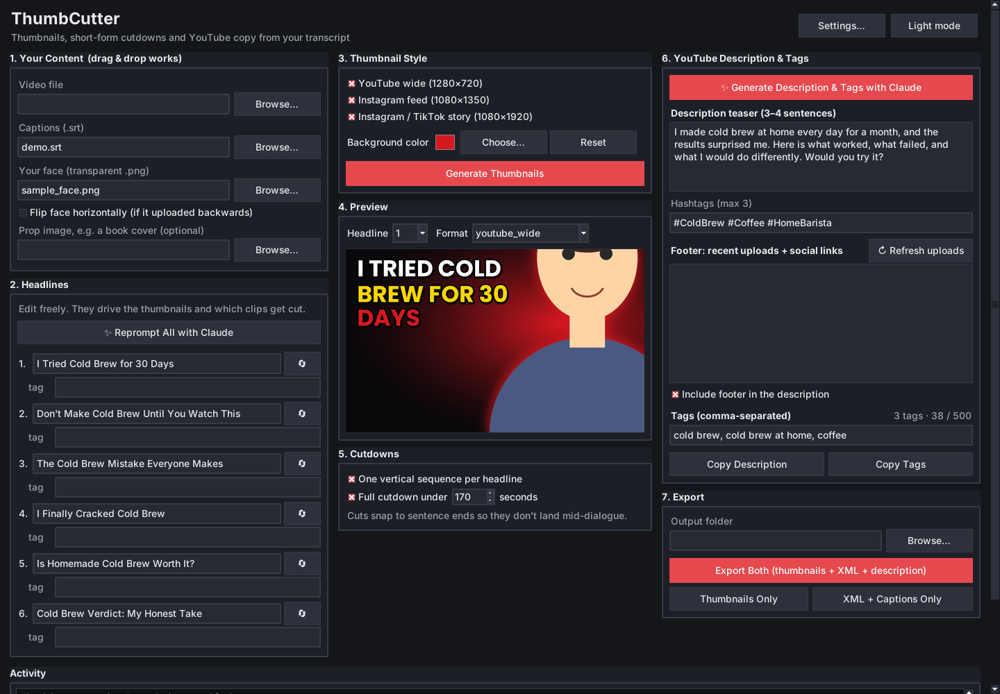

# ThumbCutter

A desktop app for YouTube creators. Give it a video, its captions (`.srt`) and a transparent PNG of your face, and it produces:

- **Headline thumbnails** in three sizes: YouTube wide (1280x720), Instagram feed (1080x1350) and Instagram/TikTok story (1080x1920)
- **Premiere Pro cutdowns**: a `cutdowns.xml` with one vertical sequence per headline, plus one "everything, under N seconds" sequence for Reels and TikTok. Cuts snap to sentence boundaries so clips don't start or end mid-sentence.
- **Retimed `.srt` captions** for every cutdown
- **A YouTube description, tags and hashtags** written by Claude, with an optional footer that lists your two latest uploads and your social links

Everything runs locally. Only your transcript text is sent to Anthropic, and only if you add your own API key.



## Download

Grab the latest build from the [Releases page](../../releases) (Windows `.zip` or macOS `.zip`), unzip it and run `ThumbCutter`.

The apps are **not code-signed**, so your OS will warn you the first time:

- **Windows:** SmartScreen shows "Windows protected your PC". Click **More info > Run anyway**.
- **macOS:** right-click `ThumbCutter.app` and choose **Open**, then confirm. The release is built for Apple Silicon Macs; on an Intel Mac, run from source instead.

## Run from source

Requires Python 3.10+ with Tkinter.

```bash
git clone https://github.com/YOUR-USERNAME/thumbcutter.git
cd thumbcutter
pip install -r requirements.txt
python app.py
```

- **Windows / macOS (python.org installer):** Tkinter is included.
- **macOS (Homebrew Python):** `brew install python-tk`
- **Linux:** `sudo apt install python3-tk`

To export Premiere XML you also need [ffmpeg](https://ffmpeg.org/download.html) (specifically `ffprobe`) on your PATH. It is only used to read your video's frame rate and size. Without it, thumbnails and captions still export and the app tells you the XML was skipped.

## How to use it

1. **Your Content:** choose your video, your `.srt`, and a transparent PNG of your face. Optionally add a prop image such as a book cover. Tick **Flip face horizontally** if the PNG came out mirrored.
2. **Headlines:** edit the six headlines, or let Claude suggest them from your transcript. Each headline also decides which part of the video is cut for it, so wording that matches what you actually say works best.
3. **Thumbnail Style:** pick formats and a background color, then **Generate Thumbnails** and flip through them in **Preview**.
4. **Cutdowns:** choose per-headline sequences, a full cutdown under N seconds, or both.
5. **YouTube Description & Tags:** generate, edit and copy.
6. **Export:** pick a folder, then **Export Both**, **Thumbnails Only** or **XML + Captions Only**. Everything is also zipped into `ThumbCutter_export.zip`.
7. In Premiere, import `cutdowns.xml`, relink the media to your full-resolution file and reframe each 1080x1920 sequence.

## Claude-powered writing (optional)

Open **Settings** and paste your own [Anthropic API key](https://console.anthropic.com/settings/keys). This is a separate pay-as-you-go key, not your claude.ai login.

- The key is stored in plain text at `~/.thumbcutter/config.json` on your computer and is only sent to `api.anthropic.com`.
- Only the **transcript text** is sent. No video, audio or images, so suggestions can't reference anything visual.
- **Headlines** follow YouTube packaging practice: under 60 characters, the main keyword up front, a curiosity gap the video pays off, and a different angle for each of the six.
- **Description** is a 3-4 sentence teaser with the keyword in the first ~100 characters and a closing question. **Tags** are kept under YouTube's 500-character limit. Three hashtags are added.
- If suggestions fail with "model not found", change the model name in Settings to a current one.

### Description footer

In **Settings**, add your YouTube channel (an `@handle`, a channel URL, or a channel ID starting with `UC`) and your social links, one per line as `Label: https://...`. The footer then lists your two most recent regular uploads (Shorts and live streams are skipped) followed by your links. Uploads come from YouTube's public feed, so no login or API key is needed. If the @handle lookup fails, paste your channel ID instead (YouTube Studio > Settings > Channel > Advanced settings).

## Limits worth knowing

- **Cuts are a first pass.** Clips are chosen by matching headline keywords to caption lines, then snapping to sentence boundaries by punctuation and timing. It doesn't understand meaning. Skim the picked lines (shown in the Activity log) before you cut, and reword a headline if it picks the wrong moment.
- **The XML is tested against the Premiere XMEML format, not against every Premiere version.** If your version complains, please open an issue.
- **Transcript only.** Nothing watches or listens to your video.

## Build the apps yourself

```bash
pip install -r requirements-build.txt
python app.py --selftest        # quick headless check
pyinstaller --noconfirm ThumbCutter.spec
```

Or run `build_windows.bat` / `build_mac.sh`. A GitHub Actions workflow (`.github/workflows/build.yml`) builds both on every push, and attaches them to a release when you push a tag like `v1.0.0`.

## Project layout

```
app.py                 the GUI
core/
  cuts.py              SRT parsing, headline matching, Premiere XML + caption export
  thumbs.py            thumbnail rendering
  ai.py                Claude prompts and output guardrails
  channel.py           latest-uploads lookup and description footer
  settings.py          local settings file
assets/fonts/          Poppins Bold (SIL Open Font License, see OFL.txt)
```

## License

MIT, see [LICENSE](LICENSE). The bundled Poppins font is licensed separately under the [SIL Open Font License 1.1](assets/fonts/OFL.txt).
